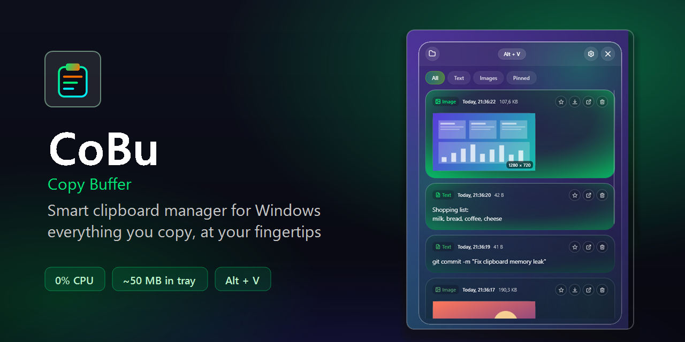
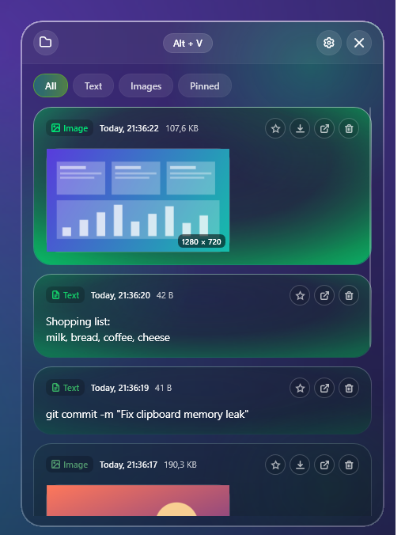
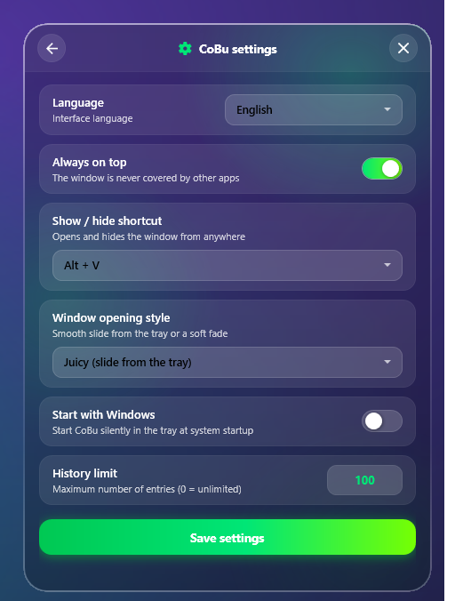

<div align="center">

<b>English</b> &nbsp;·&nbsp; <a href="README.ru.md">Русский</a>

<br><br>



<br>

<a href="https://github.com/perrarancino/Cobu/releases/latest/download/CoBu-Setup.exe"></a>
&nbsp;
<a href="https://github.com/perrarancino/Cobu/releases/latest/download/CoBu-Portable.zip"></a>
&nbsp;
<a href="https://github.com/perrarancino/Cobu/stargazers"></a>

<p>
  <a href="#about"><b>About</b></a> &nbsp;·&nbsp;
  <a href="#features"><b>Features</b></a> &nbsp;·&nbsp;
  <a href="#installation"><b>Installation</b></a> &nbsp;·&nbsp;
  <a href="#controls"><b>Controls</b></a> &nbsp;·&nbsp;
  <a href="#build-from-source"><b>Build</b></a> &nbsp;·&nbsp;
  <a href="https://github.com/perrarancino/Cobu/issues"><b>Bugs &amp; ideas</b></a>
</p>

<a href="https://github.com/perrarancino/Cobu/releases/latest"></a>
<a href="https://github.com/perrarancino/Cobu/releases"></a>
<a href="LICENSE"></a>


<br><br>


</div>

<br>

##  About

**CoBu** (Copy Buffer) is a lightweight clipboard manager. It automatically remembers everything you copy: text, links, screenshots and images. Any entry can be put back into the clipboard with one click.

The window opens with **`Alt + V`**, lives in the tray and stays out of your way: while it is hidden, the program uses almost nothing.

<br>

<div align="center">
<table>
  <tr>
    <td align="center"><br><sub><b>History: text and images</b></sub></td>
    <td align="center"><br><sub><b>Settings</b></sub></td>
  </tr>
</table>
</div>

<br>

##  Features

<table>
  <tr>
    <td width="33%" valign="top">
      <h3> Lightweight</h3>
      No polling: CoBu listens to the Windows clipboard notification. About 50 MB in the tray and no CPU load when idle. Memory does not grow over time: the list is virtualized, long texts are kept on disk, and the hidden window hands memory back to the system.
    </td>
    <td width="33%" valign="top">
      <h3> Text and images</h3>
      Texts are saved as <code>.txt</code>, images as <code>.png</code>. Exact duplicates are not created: the entry simply moves to the top.
    </td>
    <td width="33%" valign="top">
      <h3> Pinning</h3>
      Pin important entries with a star and they will never be pushed out by the history limit.
    </td>
  </tr>
  <tr>
    <td valign="top">
      <h3> Private</h3>
      Everything stays on your disk, next to the program. Anything password managers mark as secret is never recorded.
    </td>
    <td valign="top">
      <h3> Silent autostart</h3>
      Starts with Windows straight into the tray, without a sliding window.
    </td>
    <td valign="top">
      <h3> Beautiful glass window</h3>
      Dark frosted glass, smooth animations, vector icons.
    </td>
  </tr>
</table>

<br>

##  Installation

**1.** Download **[CoBu-Setup.exe](https://github.com/perrarancino/Cobu/releases/latest/download/CoBu-Setup.exe)**.<br>
**2.** Run it. The installer checks for the [.NET Desktop Runtime 10](https://dotnet.microsoft.com/download/dotnet/10.0) and offers to download and install it if it is missing.<br>
**3.** Tick the options (autostart, desktop shortcut) and click Install.

You can install just for yourself (no administrator rights needed) or for all users, into `Program Files`.

> [!NOTE]
> The installer is not code-signed yet, so Windows SmartScreen may show "Windows protected your PC". Click **More info → Run anyway**. The source code is open, so you can also build the program yourself.

**Portable:** [CoBu-Portable.zip](https://github.com/perrarancino/Cobu/releases/latest/download/CoBu-Portable.zip). Unpack and run `CoBu.exe` (needs the .NET Desktop Runtime 10).

<br>

##  Controls

| | Action | How |
|:-:|---|---|
|  | Show / hide the window | `Alt + V` (Settings also offers `Ctrl + Shift + V`, `Ctrl + ~`, `Alt + C`) |
|  | Copy an entry back | Click the card |
|  | Pin an entry | Star on the card |
|  | Close the window | `Esc` or `✕` |
|  | Change the language | Settings → Language (English or Русский; by default it follows Windows) |
|  | Menu, settings, exit | Right-click the tray icon |

<br>

##  Build from source

You need the [.NET 10 SDK](https://dotnet.microsoft.com/download/dotnet/10.0).

```powershell
git clone https://github.com/perrarancino/Cobu.git
cd Cobu
dotnet run --project src/CoBu
```

Installer and portable archive (needs [Inno Setup 6.3+](https://jrsoftware.org/isinfo.php)):

```powershell
powershell -ExecutionPolicy Bypass -File installer\build-installer.ps1
```

The result appears in the `dist` folder.

<details>
<summary>Project structure</summary>

```
Cobu/
├── src/CoBu/
│   ├── Services/
│   │   ├── ClipboardMonitor.cs    # clipboard listener, writes images through Win32
│   │   ├── StorageService.cs      # history storage (.txt / .png / history.json)
│   │   ├── SettingsService.cs     # settings and autostart
│   │   ├── Loc.cs                 # English / Russian interface strings
│   │   ├── HotkeyManager.cs       # global hotkeys
│   │   ├── TrayIconManager.cs     # tray icon
│   │   ├── WindowBlurHelper.cs    # frosted glass effect
│   │   ├── MemoryTrimmer.cs       # gives memory back to the system while hidden
│   │   └── AppPaths.cs            # where the data lives
│   ├── Models/                    # ClipItem, AppSettings
│   ├── Converters/                # UI converters
│   ├── Styles/Theme.xaml          # theme
│   └── MainWindow.xaml(.cs)       # main window
├── installer/                     # Inno Setup script and installer build
└── docs/                          # images for the README
```

</details>

<br>

##  License

[MIT](LICENSE)

<br>

<div align="center">

###  Like CoBu?

If CoBu is useful to you, give the repository a star: it helps other people find the project.

<a href="https://github.com/perrarancino/Cobu"></a>

<br>

<a href="https://star-history.com/#perrarancino/Cobu&Date">
  <picture>
    <source media="(prefers-color-scheme: dark)" srcset="https://api.star-history.com/svg?repos=perrarancino/Cobu&type=Date&theme=dark">
    
  </picture>
</a>

</div>
