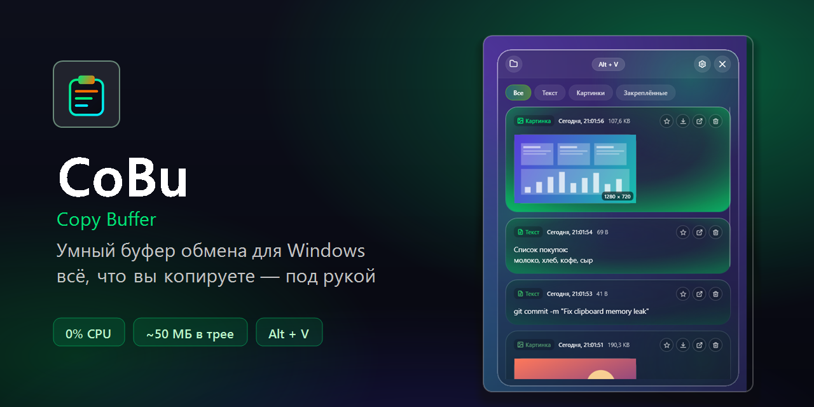
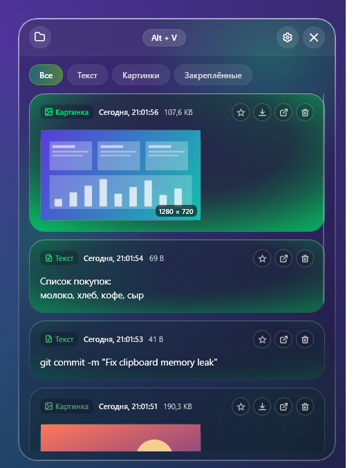
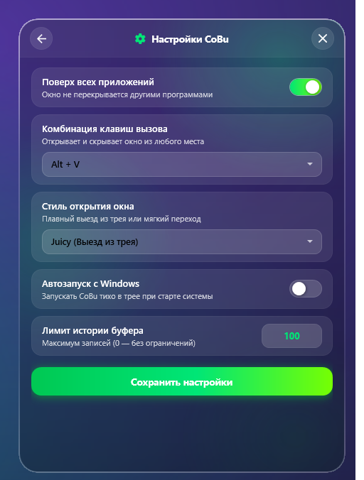

<div align="center">



<br>

<a href="https://github.com/perrarancino/Cobu/releases/latest/download/CoBu-Setup.exe"></a>
&nbsp;
<a href="https://github.com/perrarancino/Cobu/releases/latest/download/CoBu-Portable.zip"></a>
&nbsp;
<a href="https://github.com/perrarancino/Cobu/stargazers"></a>

<p>
  <a href="#-о-программе"><b>О программе</b></a> &nbsp;·&nbsp;
  <a href="#-возможности"><b>Возможности</b></a> &nbsp;·&nbsp;
  <a href="#-установка"><b>Установка</b></a> &nbsp;·&nbsp;
  <a href="#-управление"><b>Управление</b></a> &nbsp;·&nbsp;
  <a href="#-сборка-из-исходников"><b>Сборка</b></a> &nbsp;·&nbsp;
  <a href="https://github.com/perrarancino/Cobu/issues"><b>Баги и идеи</b></a>
</p>

<a href="https://github.com/perrarancino/Cobu/releases/latest"></a>
<a href="https://github.com/perrarancino/Cobu/releases"></a>
<a href="LICENSE"></a>


<br><br>


</div>

<br>

## 💡 О программе

**CoBu** (Copy Buffer) — лёгкий менеджер буфера обмена. Он сам запоминает всё, что вы копируете: текст, ссылки, скриншоты и картинки. Любую запись можно вернуть в буфер одним кликом.

Окно открывается по **`Alt + V`**, живёт в трее и не мешает работе: когда оно скрыто, программа почти ничего не потребляет.

<br>

<div align="center">
<table>
  <tr>
    <td align="center"><br><sub><b>История: текст и картинки</b></sub></td>
    <td align="center"><br><sub><b>Настройки</b></sub></td>
  </tr>
</table>
</div>

<br>

## ✨ Возможности

<table>
  <tr>
    <td width="33%" valign="top">
      <h3>🪶 Лёгкая</h3>
      Опрос буфера не нужен: CoBu слушает системное уведомление Windows. В трее занимает около 50 МБ, процессор в простое не нагружает. Память не растёт со временем: список виртуализирован, большие тексты лежат на диске, а скрытое окно возвращает память системе.
    </td>
    <td width="33%" valign="top">
      <h3>🖼️ Текст и картинки</h3>
      Тексты сохраняются как <code>.txt</code>, изображения как <code>.png</code>. Точные дубликаты не плодятся: запись просто поднимается наверх.
    </td>
    <td width="33%" valign="top">
      <h3>⭐ Закрепление</h3>
      Нужные записи можно закрепить звездой, и они не вытеснятся лимитом истории.
    </td>
  </tr>
  <tr>
    <td valign="top">
      <h3>🔒 Приватность</h3>
      Всё хранится только на вашем диске, рядом с программой. То, что менеджеры паролей помечают как секрет, CoBu не записывает.
    </td>
    <td valign="top">
      <h3>🚀 Тихий автозапуск</h3>
      С Windows стартует сразу в трей, без выезжающего окна.
    </td>
    <td valign="top">
      <h3>🪟 Красивое стеклянное окно</h3>
      Тёмное матовое стекло, плавные анимации, векторные иконки.
    </td>
  </tr>
</table>

<br>

## 📥 Установка

**1.** Скачайте **[CoBu-Setup.exe](https://github.com/perrarancino/Cobu/releases/latest/download/CoBu-Setup.exe)**.<br>
**2.** Запустите. Установщик сам проверит [.NET Desktop Runtime 10](https://dotnet.microsoft.com/download/dotnet/10.0) и, если его нет, предложит скачать и поставить.<br>
**3.** Отметьте галочки (автозапуск, ярлык на рабочем столе) и нажмите «Установить».

Установить можно только для себя (без прав администратора) или для всех пользователей, в `Program Files`.

> [!NOTE]
> Установщик пока не подписан сертификатом, поэтому Windows SmartScreen может показать «Защитник Windows предотвратил запуск». Нажмите **Подробнее → Выполнить в любом случае**. Исходный код открыт, программу можно собрать самому.

**Portable:** [CoBu-Portable.zip](https://github.com/perrarancino/Cobu/releases/latest/download/CoBu-Portable.zip) — распаковать и запустить `CoBu.exe` (нужен .NET Desktop Runtime 10).

<br>

## 🎮 Управление

| | Действие | Как |
|:-:|---|---|
| 👁️ | Показать / скрыть окно | `Alt + V` (в настройках есть ещё `Ctrl + Shift + V`, `Ctrl + ~`, `Alt + C`, `Win + Shift + V`) |
| 📋 | Скопировать запись обратно | Клик по карточке |
| ⭐ | Закрепить запись | Звезда на карточке |
| ❌ | Закрыть окно | `Esc` или `✕` |
| ⚙️ | Меню, настройки, выход | Правый клик по значку в трее |

<br>

## 🔧 Сборка из исходников

Нужен [.NET 10 SDK](https://dotnet.microsoft.com/download/dotnet/10.0).

```powershell
git clone https://github.com/perrarancino/Cobu.git
cd Cobu
dotnet run --project src/CoBu
```

Установщик и portable-архив (нужен [Inno Setup 6.3+](https://jrsoftware.org/isinfo.php)):

```powershell
powershell -ExecutionPolicy Bypass -File installer\build-installer.ps1
```

Результат появится в папке `dist`.

<details>
<summary>Структура проекта</summary>

```
Cobu/
├── src/CoBu/
│   ├── Services/
│   │   ├── ClipboardMonitor.cs    # слушатель буфера обмена, запись картинок через Win32
│   │   ├── StorageService.cs      # хранение истории (.txt / .png / history.json)
│   │   ├── SettingsService.cs     # настройки и автозапуск
│   │   ├── HotkeyManager.cs       # глобальные горячие клавиши
│   │   ├── TrayIconManager.cs     # значок в трее
│   │   ├── WindowBlurHelper.cs    # эффект матового стекла
│   │   ├── MemoryTrimmer.cs       # возврат памяти системе, пока окно скрыто
│   │   └── AppPaths.cs            # где лежат данные
│   ├── Models/                    # ClipItem, AppSettings
│   ├── Converters/                # конвертеры для интерфейса
│   ├── Styles/Theme.xaml          # тема оформления
│   └── MainWindow.xaml(.cs)       # главное окно
├── installer/                     # скрипт Inno Setup и сборка установщика
└── docs/                          # картинки для README
```

</details>

<br>

## 📄 Лицензия

[MIT](LICENSE)

<br>

<div align="center">

### ⭐ Понравился CoBu?

Если CoBu пригодился, поставьте звезду репозиторию: так проект проще найти другим.

<a href="https://github.com/perrarancino/Cobu"></a>

<br>

<a href="https://star-history.com/#perrarancino/Cobu&Date">
  <picture>
    <source media="(prefers-color-scheme: dark)" srcset="https://api.star-history.com/svg?repos=perrarancino/Cobu&type=Date&theme=dark">
    
  </picture>
</a>

</div>
